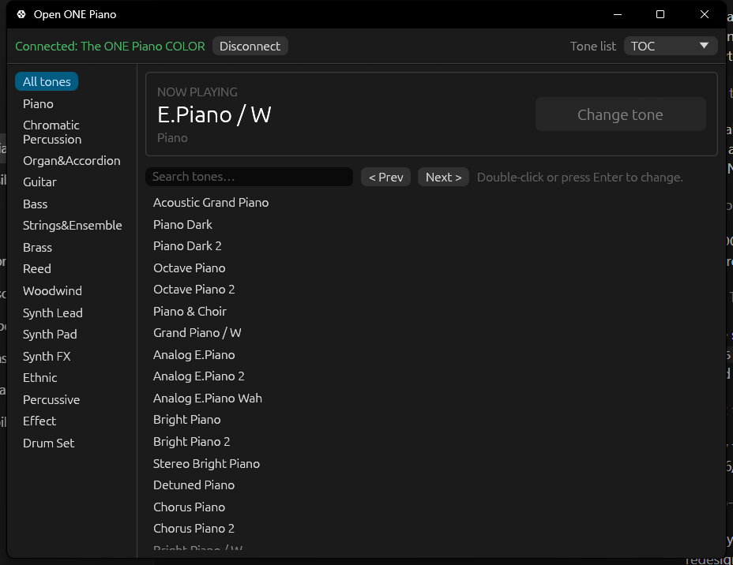
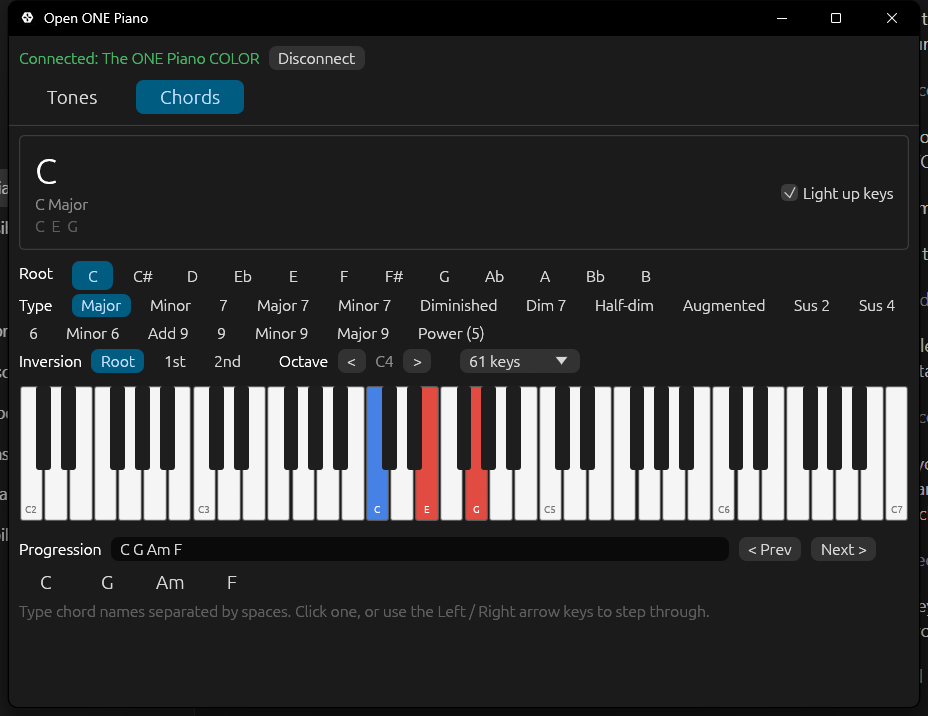

# Open ONE Piano

**Change the tone (instrument / voice / sound) of a The ONE Smart Piano or ONE Light Keyboard from your computer, and light up chords on its keys — no phone app needed.**

Open ONE Piano is a small, free, open-source desktop app for Windows, macOS and Linux. It connects to your The ONE keyboard over Bluetooth and does two things:

- **Tones:** pick any of the keyboard's built-in tones — grand pianos, electric pianos, organs, strings, synths, drums and hundreds more — from a searchable list, and the keys you play switch to it.
- **Chord shower:** pick a chord (any root, 18 chord types, any inversion) or type a progression like `C G Am F`, and the keys for each chord light up on your keyboard so you can see where to put your fingers.

It does the same thing as the tone settings in the official "Smart Piano" phone app, using the keyboard's own Bluetooth MIDI commands. The window always shows the tone the keyboard is actually playing, read back from the keyboard itself.

| Tones | Chords |
| --- | --- |
|  |  |

## Download

Grab the latest build for your system from the [Releases page](../../releases):

| System | File |
| --- | --- |
| Windows 10/11 | `open-one-piano-windows-x64.zip` — unzip and run `open-one-piano.exe` |
| macOS (Apple Silicon) | `open-one-piano-macos-arm64.zip` |
| macOS (Intel) | `open-one-piano-macos-x64.zip` |
| Linux (x64) | `open-one-piano-linux-x64.tar.gz` |

The macOS app isn't notarized: the first time, right-click it and choose **Open**. macOS will ask for Bluetooth permission.

## How to use it

1. Turn your keyboard on.
2. **Close the ONE app on your phone** (or turn off your phone's Bluetooth). The keyboard only accepts one Bluetooth connection at a time.
3. Open Open ONE Piano. It finds your keyboard and connects on its own; next time it reconnects to the same keyboard automatically.
4. **Tones:** the top of the window shows the tone that's playing now. Pick another tone from the list (use the categories, the search box, or **Prev / Next**), then press **Change tone**. Double-clicking a tone or pressing **Enter** works too.
5. **Chords:** pick a root and a chord type, and choose the inversion and octave. The chord's keys light up on your keyboard and on the drawing in the app; the root is shown in blue (on keyboards with blue LEDs). To practice a song, type its chords into **Progression** (for example `C G Am F` or `Dm7 G7 Cmaj7`, slash chords like `D/F#` work too) and step through them with the chord buttons or the **Left / Right** arrow keys.

## Supported keyboards

Anything from The ONE Music Group that works with the official Smart Piano app over Bluetooth should work. Each model has its own set of tones; the app works out which one from the tone the keyboard is playing, and you can change it with **Tone list** next to the search box.

| Tested | Model |
| --- | --- |
| ✅ | The ONE Piano COLOR (61-key) on Windows 11 |
| ❓ | ONE Light Keyboard, Keyboard Pro, Keyboard Air, Smart Piano (88-key), Hi-Lite, Smart Piano Classic — should work, untested |

The macOS and Linux builds compile and pass the tests in CI but haven't been tried against a real keyboard yet. If you try one, please open an issue saying whether it worked and which model you have.

## Troubleshooting

- **"No keyboard found"**: make sure Bluetooth is on, the keyboard is on (it switches itself off after a while), and the phone app isn't connected to it. Then click **Scan**.
- **Lights are on the wrong keys**: if you have an 88-key piano, set **88 keys** on the Chords page so chords are placed on keys you have.
- **The keys stopped making sound**: the main tone layer was switched off. Change to any tone in the app and it switches back on.
- **"The keyboard didn't accept that tone"**: the wrong tone list is selected for your model. Try another one under **Tone list**, next to the search box.
- **Linux**: you need BlueZ running, and your user needs access to Bluetooth (usually the case on desktop distros).

## Build from source

You need [Rust](https://rustup.rs) (stable).

```bash
cargo run --release
```

On Linux, install the D-Bus and GL headers first (Debian/Ubuntu: `sudo apt install libdbus-1-dev pkg-config libxkbcommon-dev libgl1-mesa-dev`).

## How it works

The keyboard speaks standard Bluetooth LE MIDI plus a few of its own SysEx commands for things like choosing the tone. [PROTOCOL.md](PROTOCOL.md) documents them, in case you want to control the keyboard from your own code.

## Disclaimer

This is an unofficial, community project. It isn't made by, affiliated with, or endorsed by The ONE Music Group. "The ONE" is their trademark and is used here only to say which keyboards this app works with. The protocol was worked out for interoperability with hardware the author owns. Use it at your own risk.

## License

[MIT](LICENSE)
